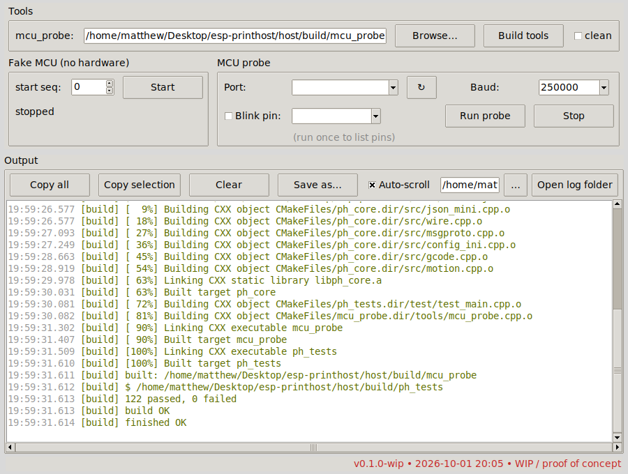
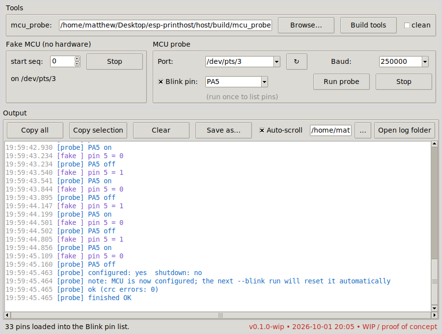
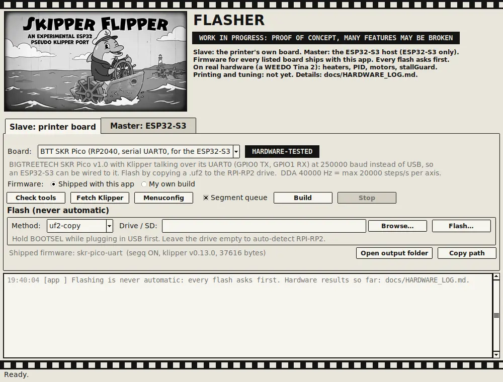

> ## WORK IN PROGRESS: MANY FEATURES MAY BE BROKEN
> **`0.1.0-wip`: mostly working, needs tuning and proper testing.** It heats, tunes, runs the motors and triggers stallGuard in a real printer, but it has not printed a part yet, and breaking changes are expected. Read [Known limitations](#known-limitations) before you plug anything in.


# Skipper Flipper

*An experimental ESP32 pseudo Klipper port.* (Repository and package name: `esp-printhost`.)

**GPL-3.0** · Linux (Mint / Ubuntu) · C++17 core + Python tools · [Project page](https://The-Dorkknight.github.io/esp-printhost/)

Licensed under the GNU General Public License v3.0, see [LICENSE](LICENSE). **No warranty and no liability:** this is provided as is. You use it at your own risk, on your own hardware, and the author is not responsible for damage to boards, printers or anything else.

## What this is

An idea for reviving old, donated 3D printers: a cheap ESP32-S3 becomes the "brain" (WiFi, web UI, text config, motion planning) and the printer's original board becomes a simple slave running a modified Klipper MCU firmware. The full plan is in [docs/DESIGN.md](docs/DESIGN.md).

**Target hardware: ESP32-S3 only** for the host ("master"). **Status: mostly working, needs tuning and proper testing.** On real hardware (see [docs/HARDWARE_LOG.md](docs/HARDWARE_LOG.md)), installed in a WEEDO Tina 2 with a BTT SKR Pico: the WiFi status page, console and `printer.cfg` editor; the Klipper link, clock sync, board configuration and recovery from board power cycles; temperatures, heating, PID tuning and Klipper's heater safety checks; the motor test; TMC2209 set-up; stallGuard triggering; the hotend fan. **Not yet confirmed:** the part-cooling fan and the third fan output (possibly a broken wire; will update when tested). **Needs tuning:** stallGuard threshold, motor current, speeds, `rotation_distance`. **Only simulated so far:** moves, full homing and probing, and printing a file. The whole story, including every mistake: **[A Frankenstein Experience](docs/paper/A_FRANKENSTEIN_EXPERIENCE.md)** ([PDF](docs/paper/A_FRANKENSTEIN_EXPERIENCE.pdf)).

| Part | State |
|---|---|
| Klipper wire protocol (CRC16, VLQ ints, framing, resync, data dictionary) | Unit-tested; **works on hardware** (ESP32-S3 to SKR Pico) |
| ESP32-S3 firmware (`firmware/esp32s3`): WiFi access point, status page, console, `printer.cfg` editor, test bench, printer page, the Klipper host's jobs (heaters, TMC2209, moves, homing, printing from flash). Shipped ready to flash | **On hardware** (to 2026-10-14): link, heating, PID, motor test, TMC2209, stallGuard trigger. Moves, homing and printing: simulation only |
| `skr-pico-uart` printer-board firmware (Klipper v0.13.0 + segment queue, serial on UART0) | **Works on hardware**: link, heater, thermistor, steppers, TMC UART, DIAG pins. The segment queue is not used by the ESP32 host |
| Segment-queue core (`firmware/skipper/segq_core.*`, shared by the firmware and the PC tests) | Working in simulation: exact step counts, step spacing, ring buffer, start threshold, underrun, stop |
| Motion planner + G-code engine (lookahead, junction deviation, trapezoids, pressure advance, G-code state) | Working in simulation: output is run through the real core and checked for exact positions, speed and acceleration limits |
| Other board presets (generic RP2040, Creality 4.2.x, RAMPS mega2560, Ender-3 1.1.x, USB SKR Pico) | **Compile only**; never run on hardware |
| Flasher app (`flasher.py`): Slave tab (printer board) and Master tab (ESP32-S3) | ESP32-S3 flashing **used on hardware** on Linux Mint. Other paths (SD card, avrdude, Windows/macOS) tested with mocks only |
| Firmware build tool (CLI + Slave tab "My own build") | Works on Linux (sandbox and the author's Linux Mint laptop); Windows needs WSL |
| `mcu_probe`, `fake_mcu.py`, one-command setup, Tools window | Working on Linux Mint. Probe tried on an SKR Pico over USB |
| Real printing | Built and **simulated only** (upload, print from flash, pause / resume / cancel); not yet run on the printer |
| Fans | Hotend fan **confirmed on hardware**; part-cooling fan and the third fan output not yet (possibly a broken wire, will update when tested) |

Total checks: 1,029 C++ unit checks and 187 Python tests (including power-cycle, stallGuard and printing runs against a simulated board), all passing in the sandbox. Passing tests mean the maths and bookkeeping are right, not that a printer will behave.

## Screenshots

The GUI building the tools and running the unit tests:



The GUI running the probe against the built-in fake MCU (simulated, no hardware):



Both screenshots use the **simulated** board, not real hardware.

## Flash a board (Linux, macOS, Windows)

```
python3 flasher.py          (Windows: double-click Flasher.bat; macOS: Flasher.command)
```

You need Python 3.8+ with Tk (Linux: `sudo apt install python3-tk`; on Windows and macOS the installer from python.org includes Tk). No toolchain is needed: firmware for every board preset (five boards, plus a serial variant of the SKR Pico) ships in `firmware/prebuilt/`. Pick the **Slave** tab, choose your board, press **Flash...** and confirm. RP2040 boards: hold BOOTSEL while plugging in USB. STM32 boards such as the Creality 4.2.x: put the SD card in this computer, **Browse** to it, flash, then move the card to the printer and power-cycle it. AVR boards need `avrdude` installed. The **Master** tab flashes an ESP32-S3 with esptool (Install esptool, then **Use shipped firmware**, pick the port, Flash). The port box fills itself with the ESP32-S3's port when it can tell which one it is (otherwise pick it). The shipped image starts a WiFi network `SkipperFlipper-XXXX` (WPA2, default password `skipperflipper`, change it before real use) with a page at `http://192.168.4.1/`, a live log at `/console` and `printer.cfg` at `/config`; it talks Klipper to the printer board over UART (identify, clock sync, LEDs and thermistors from `printer.cfg`, confirmed on hardware; heaters, fans, TMC2209 drivers and motor tests from the test bench at `/test`, simulated only so far). Moves, homing and printing a file (Printer page at `/printer`) are built and simulated, not yet run on hardware. Logs appear on the chip's native USB port. **ESP32-S3 only**: other ESP32 chips (original, S2, C3) are not supported, and esptool refuses to write if it finds a different chip. You can also flash your own `.bin`. To connect the ESP32-S3 to an SKR Pico with four jumper wires, see [docs/WIRING_SKR_PICO.md](docs/WIRING_SKR_PICO.md).



**Only the `skr-pico-uart` firmware has run on a board, and only for the link and its on-board LED**; the other presets have never been flashed. Read [docs/FIRMWARE.md](docs/FIRMWARE.md) first, and do not flash a printer you cannot recover.

## Quick start (Linux Mint / Ubuntu / Debian)

```bash
git clone https://github.com/The-Dorkknight/esp-printhost
cd esp-printhost
sudo python3 printhost.py
```

That one command installs what is missing (build tools, cmake, zlib, python3-tk, acl), gives you access to USB serial ports without logging out, stops ModemManager and brltty from grabbing printer boards, builds `mcu_probe`, runs the tests, and opens the GUI as your normal user. It is safe to re-run. [HOW_IT_WORKS.md](HOW_IT_WORKS.md) lists exactly what it changes on your system.

Options: `--check` (report only, change nothing), `--no-gui`, `--clean`, `--yes`, `--version`.

If anything fails it prints the path of a log file in `~/esp-printhost-logs/`. Attach that when you open an issue.

macOS: the C++ library and tests build (`python3 host/tools/build.py`), but `mcu_probe` is Linux-only (it uses Linux's `termios2` for 250000 baud) and the one-command setup is Linux-only.

## Using the GUI

1. **Build tools** compiles everything and runs the unit tests. Output is colour-coded per tool.
2. **Fake MCU: Start** runs a pretend Klipper board (no hardware). Its port appears in the Port box.
3. **Run probe** connects, reads the board's pin list into the **Blink pin** dropdown, and prints uptime and state. Tick **Blink pin** and pick a pin to also toggle it 10 times.
4. The output box is selectable (Ctrl+C, right-click, **Copy all**, **Save as...**). Everything is also logged to `~/esp-printhost-logs/`.

## Building and flashing firmware

Open the **Firmware** tab (or use `python3 host/tools/skipper_fw.py`), pick your board, then **Check tools**, **Fetch Klipper**, **Build**. The tool downloads Klipper v0.13.0 from GitHub into `~/.skipper-flipper/`, adds the segment queue, builds with the board's preset and saves the result with a SHA-256 list. **Flash...** shows what it is about to do and asks first. Details, per-board warnings and the speed arithmetic are in [docs/FIRMWARE.md](docs/FIRMWARE.md).

**Warning:** wrong or untested firmware can leave a board unresponsive until it is re-flashed through its bootloader. Do not flash a printer you cannot afford to recover. Presets are marked `compile-only / unverified` for a reason.

## Try it without hardware

```bash
python3 host/tools/fake_mcu.py            # prints /dev/pts/N
./host/build/mcu_probe /dev/pts/N 250000 --pins --blink PA5
```

## Try it on a real board

You need a board running **stock Klipper MCU firmware** (build it from Klipper with `make menuconfig`; this project does not ship firmware yet). Stop Klipper or anything else using the port, then:

```bash
./host/build/mcu_probe /dev/serial/by-id/<your-board> 250000 --pins --blink <pin>
```

`--pins` lists the pin names the board accepts. The probe validates your pin name before touching the board, and if the board is already configured it **resets it** first (the USB device re-appears after about two seconds). Do not run it on a board that is in the middle of a print.

Tested so far: BTT SKR Pico (RP2040, Klipper v0.10.0-181). The probe identified it, read 31 pin names, reset it, configured `gpio24` and sent 10 toggles with 0 CRC errors.

## Troubleshooting

| Symptom | Likely cause and fix |
|---|---|
| `/dev/ttyUSB0` disappears when an Ender / Creality board is plugged in | brltty grabbing the CH340 chip. Re-run `sudo python3 printhost.py` and say yes to disabling it |
| `Permission denied` on the port | Not in `dialout` yet. `printhost.py` fixes today's session; log out and in for the long term |
| `Device or resource busy` | Klipper, Cura or a serial monitor has the port open. Close it |
| `no identify_response` | Wrong port or baud, board is not running Klipper firmware, or it needs a power cycle |
| `already configured` | The probe resets it automatically; if that fails, power-cycle the board |
| GUI will not open | `sudo apt install python3-tk`, or run `python3 printhost.py --no-gui` |
| Probe says OK but nothing lights up | See [Known limitations](#known-limitations) |

## Known limitations

- **Only the link and the SKR Pico's LED have run on hardware** (ESP32-S3 and SKR Pico); clock sync, `printer.cfg` and the `SET_LED` console also ran on it for about 41 minutes (docs/HARDWARE_LOG.md); the reset-and-reconfigure after editing `printer.cfg` has not been tried on hardware. Pin polarity, DDA timer load, shutdown behaviour inside the timer, and bootloader details for the other boards are assumptions that compile but are untested. The DDA rates (8 to 40 kHz) cap speed: maximum step rate per axis is half the DDA rate.
- **Heater, fan and motor control is new and has only run in simulation** (`fake_mcu.py` and unit tests; see docs/TEST_BENCH.md). It follows Klipper's heater safety (board-side `max_duration` and ADC range checks, `verify_heater`, emergency stop), but has not been tried on real hardware: stay with the printer, keep a hand on the power switch, and do not rely on it unattended. Moves, homing and printing are newer still and have only run in simulation.
- **Pin toggle is not physically confirmed.** On the SKR Pico the test used `gpio24`, which (as far as we can tell from BTT's pin map, not verified) is the NeoPixel/RGB header. A NeoPixel needs a timed data stream, so a plain on/off will not light one. The protocol side worked; try a pin with a visible LED or a multimeter on it.
- `finalize_config` is sent with a fixed placeholder CRC, which is fine for stock firmware but is not a real config checksum yet.
- The ESP-IDF build of the library is untested; only the PC build is exercised. The planner emits about one segment per tiny move, so link bandwidth for very fine G-code is unmeasured.
- Not in the segment queue yet: sync pin actions, endstop homing during a segment.
- `mcu_probe` is Linux-only.
- The GitHub workflows in `.github/workflows/` have not been run yet.
- Presets for boards with clone chips (some Creality 4.2.x) are flagged unverified; check your chip.
- Design documents describe intent, not finished work. Segment-queue commands (`segq_*`) are a draft and exist only in the simulator.

## Project layout

```
printhost.py          one-command setup + launcher
flasher.py            the Flasher window (also Flasher.bat / Flasher.command)
HOW_IT_WORKS.md       what it reads, changes and never does
docs/                 DESIGN, PROTOCOL (draft v1), ENGINE, FIRMWARE, TASKS, project page
firmware/skipper/     segq_core (portable C core) + segq.c (Klipper glue)
firmware/esp32s3/       ESP32-S3 firmware (ESP-IDF project) + build.sh
firmware/prebuilt-esp32s3/  shipped ESP32-S3 image
firmware/boards/      board presets (.config + .json)
firmware/prebuilt/    shipped firmware per board (+ pin tables); refresh with skipper_fw.py bundle
firmware/test/        PC simulation of the Klipper glue
host/                 portable C++17 core (also an ESP-IDF component, untested)
  include/ph/         wire, msgproto, json_mini, config_ini, gcode, motion, planner, engine
  src/  test/         implementation + 480 unit tests
  tools/              build.py, skipper_fw.py, printhost_gui.py (+ fw_panel, skipper_theme),
                      mcu_probe.cpp, fake_mcu.py
```

## Roadmap

See [docs/TASKS.md](docs/TASKS.md). Next: real Klipper behaviour on the ESP32-S3, in stages: clock sync, configuring the board from `printer.cfg`, a harmless first action (LED), temperatures, then heaters with safety checks and motor tests (built, waiting for the hardware test), then real moves and homing, then printing a file. The look is a 1928 black-and-white cartoon (visuals only); a Benchy-themed pass is planned for when real building starts.

## Contributing, security, third-party

[docs/HARDWARE_LOG.md](docs/HARDWARE_LOG.md) (everything tested on real hardware) · [docs/WIRING_SKR_PICO.md](docs/WIRING_SKR_PICO.md) (ESP32-S3 to SKR Pico wiring) · [docs/TEST_BENCH.md](docs/TEST_BENCH.md) (test page and heater safety) · [docs/TINA2_INSTALL.md](docs/TINA2_INSTALL.md) (WEEDO Tina 2 installation) · [docs/research/klipper-sources.md](docs/research/klipper-sources.md) (research notes) · [CONTRIBUTING.md](CONTRIBUTING.md) · [SECURITY.md](SECURITY.md) · [THIRD_PARTY.md](THIRD_PARTY.md) · [CHANGELOG.md](CHANGELOG.md)

Copyright (C) 2026 Matthew Armstrong ([The-Dorkknight](https://github.com/The-Dorkknight)).
