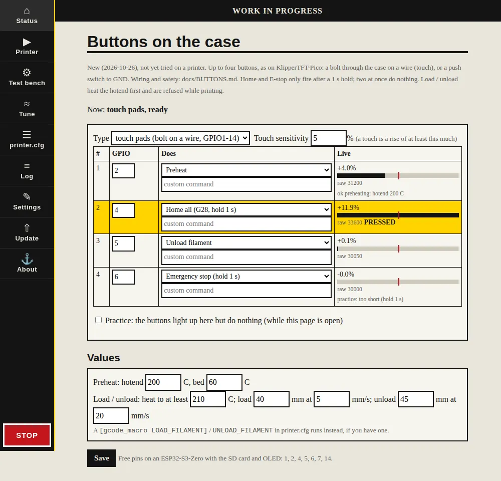
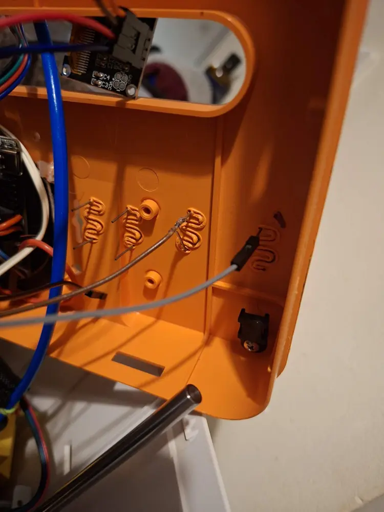

# Buttons on the case (touch pads or switches)

**Status (2026-10-26, evening): touch works on hardware.** On the Tina 2, Preheat and Home fired from
touch pads embedded in the case (see "Pads made from plastic-welder staples" below; HARDWARE_LOG.md).
The other two pads were not connected yet. Unload, the E-stop hold and the two-at-once guard have
only been tested on the PC so far.
CAPTAIN and SKIPPER builds only (DECKHAND's 2 MB flash is full). Same idea as KlipperTFT-Pico's
buttons: up to four, with the defaults except the second button, which homes instead of loading filament (2026-10-26).



## What they do

| Button | Default GPIO | Default action | Console command it runs |
|---|---|---|---|
| 1 | GPIO2 | Preheat | `SF_PREHEAT EXTRUDER=200 BED=60` (no waiting) |
| 2 | GPIO4 | Home all, **only after a 1 s hold** | `G28` |
| 3 | GPIO5 | Unload filament | `SF_UNLOAD_FILAMENT TEMP=210 LENGTH=45 SPEED=20` |
| 4 | GPIO6 | Emergency stop, **only after a 1 s hold** | `M112` |

Each button can do any of these instead: Load filament
(`SF_LOAD_FILAMENT TEMP=210 LENGTH=40 SPEED=5`), Cool down (`SF_COOLDOWN`), Pause / resume the print
(`SF_PAUSE_RESUME`), a custom command (a `[gcode_macro]` name or any console
line), or nothing. The values (preheat temperatures, load temperature, lengths and speeds) are on
the same page.

- **Load / unload** heat the hotend first and wait for it (to at least the load temperature, never
  cooler than it already is, never below `min_extrude_temp` + 5). Unload pushes 5 mm first so the tip
  softens, then pulls back. If printer.cfg has a `[gcode_macro LOAD_FILAMENT]` or
  `[gcode_macro UNLOAD_FILAMENT]`, that runs instead (the usual Klipper names).
- **Refused while printing** (and while a macro, homing, probing or a test runs): Preheat, Cool down,
  Load, Unload. Pause / resume is the only one that works during a print. The E-stop always works.
- The OLED shows what was pressed for a moment: PREHEAT, LOAD, UNLOAD, E-STOP, ...; **NOT NOW** or
  **PRINTING** when refused; **HOLD 1 S** after a short tap on the E-stop. Then HEATING and LOADING as
  they happen.
- **Home and the E-stop need a 1 s hold**, so brushing against the case cannot move or stop the
  printer. Home is refused while printing.
- **Two buttons at once count as none** (wires shorted together, a hand across two bolts); the OLED
  says **2 AT ONCE**. Bare wires touching would otherwise make one bolt fire both buttons.
- The first 2 seconds after a start are ignored (hands off: the pads learn their untouched level).

## Wiring touch pads (bolts on the case)

One wire from each bolt to its GPIO. That is all: **no pull-up and no ground wire.** The ESP32-S3
measures the capacitance of the pin; a finger on the bolt raises it.

```
  bolt head (outside)        ESP32-S3
  ===[|]===  case   ---- 220R ---- GPIO2      (repeat for GPIO4, GPIO5, GPIO6)
```

- **Resistor:** not needed for it to work. A **100-470 ohm resistor in series**, at the ESP32 end of the
  wire, is recommended: bare bolts collect static from fingers and this protects the pin.
- **The bolts must only touch the plastic case.** Not the metal frame, a motor, the power supply,
  or anything earthed: a grounded bolt reads as permanently touched (or never). Use a plastic washer
  if a bolt sits near metal.
- **Short wires** (under about 30 cm), not bundled with the stepper or heater wires (they would cause
  false touches). Plain single wire is fine; a bigger bolt head or a washer under it is more sensitive.
- **Touch pins:** GPIO1-14 only. Free on an ESP32-S3-Zero with the SD card (10-13) and OLED (8, 9):
  **1, 2, 4, 5, 6, 7, 14**. GPIO3 is a start-up pin and is refused.

## Pads made from plastic-welder staples (what the Tina 2 uses)

The author's first pads, 2026-10-26: no bolts, no holes. The wave ("curly") staples of a hot-staple
plastic welder (the kind sold for repairing car bumpers) were heated with the welder and pushed about
**halfway into the case wall from the inside**, then twisted slightly so they sit deeper in the
plastic. The finger touches the **outside** of the case over the staple: the ESP32-S3 senses it
through the remaining plastic. One leg of each staple was snapped off; a breadboard-style female
Dupont jumper goes on the other leg (the legs are thicker than a header pin, so it takes some force)
and runs to the GPIO.



- Sensitivity **10 %** worked for Preheat and Home on the first try.
- No hole through the case, nothing to touch electrically from outside, and no static can reach the pin.
- **Weak point: the contact.** Staples are spring steel, which oxidises and does not take solder
  easily, and a Dupont socket stretched over a thick leg may not grip. Check each one with a
  multimeter (continuity from the GPIO pin to the staple). Better joints: wrap a few tight turns of
  bare copper wire round the leg and solder the copper to itself, or use a crimped ring / spade terminal.
- **Diagnosis from the page:** the live "raw" number of a pad with its staple connected was about
  19,600-20,500 on this board; a pin with nothing (or a bad contact) on it reads clearly lower (about
  14,700 was seen). "raw 0" means that button is set to Nothing (not read at all).

## Wiring push switches instead

Type "push switches to GND": each switch between its GPIO and GND. The internal pull-up is used; no
resistors. Any free GPIO works (not only 1-14).

## Setting up (Settings, then "Set them up", or `/buttons`)

1. Pick the type (touch pads or switches), the pins and what each button does. **Save.**
2. Tick **Practice**: while it is ticked and the page is open, the buttons light up on the page but do
   nothing.
3. Touch each bolt and watch its live reading: the bar shows the rise; the red mark is the sensitivity
   (default **5 %**). Set the sensitivity to about **half the rise you see** when touching (a bolt on
   a long wire may only rise 3-10 %; a big pad more). Untouched it should sit near 0 %.
4. Untick Practice. Try Preheat with the printer watched.

A pad that reads "touched" for 20 s on end is taken as its new untouched level, so something leaning on
it (or a cable that moved) cannot hold a button down. Slow changes (a warming room) are followed.

## Things to know

- Nothing here has run on real hardware yet; the timing and touch logic is unit-tested on the PC
  (`test_panel` in `host/test/test_toolhead.cpp`), and the commands run against the simulated board.
- The E-stop from a button goes through the same queue as the web console, so it waits behind
  whatever the ESP32 is doing at that moment (normally a few milliseconds). It is a convenience,
  **not a safety device**: keep a hand near the power switch, as for everything else here.
- The accelerometer search (Tune page) leaves the button pins alone.
- Files: `firmware/esp32s3/main/panel.cpp` (pins, page), `host/src/panel.cpp` (touch and press logic),
  `host/src/machine_panel.cpp` (the SF_ commands).
