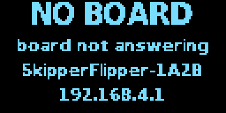
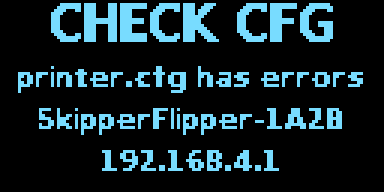
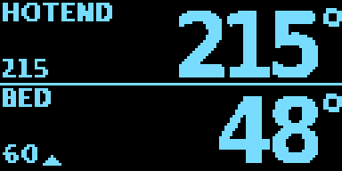
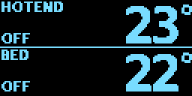
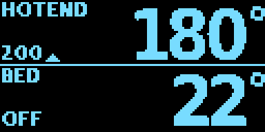
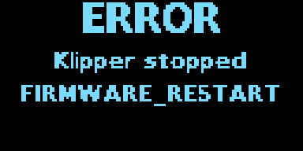

# Little OLED display

**Status (2026-10-26): works on a real display** (0.96" two-colour SSD1306-type module on GPIO8/9, ESP32-S3-Zero, CAPTAIN; idle temperatures and the board-shutdown screen seen; see HARDWARE_LOG.md). Built into all three firmware builds. Since 2026-10-26 it also flashes what a button on the case did (PREHEAT, LOAD, NOT NOW, HOLD 1 S; [BUTTONS.md](BUTTONS.md)). Before that (2026-10-23): What
has been checked: the drawing code's own tests on the PC (`oled_tests`); the new "what is the printer
doing" logic in the machine (`test_display_info` in `ph_tests`: homing, extruding, retracting,
loading, unloading, print state, and that a print's own retractions do not flash up); the screens
below are drawn by the firmware's own code; all three builds compile; under QEMU the DECKHAND build
starts the display task, looks for a display three times on an empty bus and gives up without a crash.

The drawing code and the I2C driver come from KlipperTFT-Pico 0.6.1 (same author), see
[research/oled-from-klippertft.md](research/oled-from-klippertft.md). Here they are GPL-3.0 like the
rest of Skipper Flipper.

## Which modules

Any of the cheap 4-pin I2C OLEDs (GND, VCC, SCL, SDA), about £3:

| Module | Settings page "Type" |
|---|---|
| 0.96" 128x64, SSD1306 or SSD1315 (white, blue, or yellow/blue two-colour) | 0.96in 128x64 (default) |
| 0.91" 128x32, SSD1306 | 0.91in 128x32 |
| 1.3" 128x64, SH1106 | 1.3in 128x64, SH1106 |

The ESP32 looks for it at I2C address 0x3C, then 0x3D, three times over the first 10 seconds after a
start (a display powered from the printer board may wake up later than the ESP32). If nothing answers
it stops looking until the next restart and gives its memory back; the status page and the Settings
page say what it found ("SSD1306 128x64 at 0x3C", "not found on GPIO8/GPIO9"). If a working display
stops answering (unplugged), it looks again every 5 s.

## Wiring (ESP32-S3-Zero type board)

| OLED | ESP32-S3 |
|---|---|
| GND | GND |
| VCC | 3V3 |
| SDA | GPIO8 |
| SCL | GPIO9 |

GPIO8 and GPIO9 sit next to the SD card's GPIO10-13 on the ESP32-S3-Zero. Any other two free pins work
(Settings page: SDA GPIO, SCL GPIO). The Settings page refuses pins that are already in use (printer
board UART, status LED, SD card), the USB pins 19/20, the start-up pins 0, 3, 45, 46 and GPIO26-37
(flash and PSRAM on most boards). The modules have their own pull-up resistors.

Plan it like the SD card ([SD_CARD.md](SD_CARD.md)): the ESP32-S3-Zero is mirrored when seen from the
back, so mark the pins before soldering.

Mounted upside down: Settings page, "Mounted: upside down". To switch it off and free the pins:
"Type: none".

## Screens

Drawn by the firmware's own code (`firmware/esp32s3/components/ktft_oled/tools/make_oled_previews.py`).
The screen changes 5 times a second; the printer's state behind it twice a second.

| | 128x64 | 128x32 |
|---|---|---|
| No printer board: why, the ESP32's WiFi name, and in turn its password... |  |  |
| ...and the page's address (every 4 s) |  |  |
| printer.cfg not accepted |  |  |
| Not printing: hotend and bed, target and a heating / cooling arrow |  |  |
| Heaters off |  |  |
| Printing: percentage and progress bar |  |  |
| Paused (alternates with the percentage every 2 s) |  |  |
| Doing something: the temperatures... |  |  |
| ...with the action flashing up 2 s in every 4 s (LOADING) |  |  |
| HOMING |  |  |
| HEATING (a print or macro waits for a temperature) |  |  |
| The board shut down (Restart button or FIRMWARE_RESTART) |  |  |

What flashes up, and when (`ph::Machine::display_info`, unit-tested):

- **HEATING**: a print or a macro waits for M109 / M190.
- **HOMING**: homing or probing runs.
- **EXTRUDING / RETRACTING**: a move of the extruder alone, outside a print (console, macro, the
  Printer page's extrude and retract buttons). From 20 mm: **LOADING / UNLOADING**. Each lasts as long
  as the move should take (length / speed) plus a second.
- Nothing during a print except the percentage: a print's own retractions would flash all the time.

Without `[extruder]` / `[heater_bed]` in printer.cfg, the readings of `[temperature_sensor hotend]`
and `[temperature_sensor bed]` are shown instead.

## Cost

About 45 KB of flash (the fonts are about 8 KB), 1.5 KB of RAM and a 4 KB task while a display is
there. The DECKHAND build now has 2% of its app space left (28 KB): the next feature for DECKHAND
needs something taken out first. CAPTAIN has 16% left, SKIPPER 54%.

## For maintainers

| Where | What |
|---|---|
| `firmware/esp32s3/components/ktft_oled/` | framebuffer, fonts, screen layouts, I2C driver (ESP-IDF `i2c_master`) |
| `firmware/esp32s3/main/oled.cpp` | the display task: fills the screen from the link (`sf_link_get`) and the machine (`sf_display_get`), settings, pin checks |
| `host/src/machine.cpp` `display_info()` | what the printer is doing, tested in `host/test/test_toolhead.cpp` |
| `firmware/esp32s3/components/ktft_oled/tests/oled_test.cpp` | layout tests, built as `oled_tests` with the host tests |
| `.../tools/make_oled_fonts.py` | regenerates the fonts from DejaVu (Pillow; checked 2026-10-23: same file) |
| `.../tools/make_oled_previews.py` | redraws the pictures above into `docs/images/oled/` |
