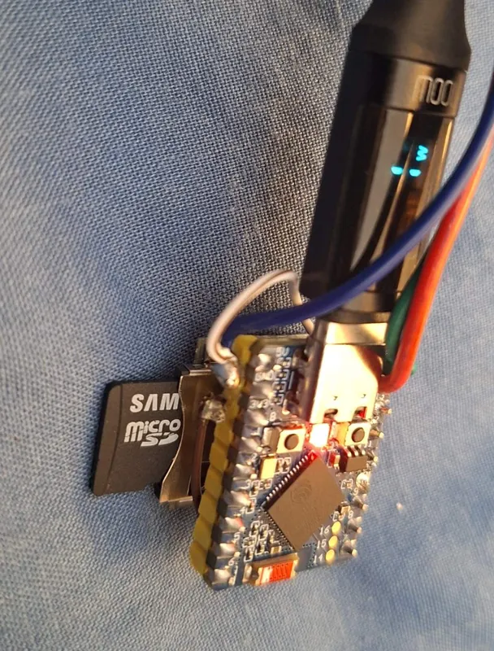
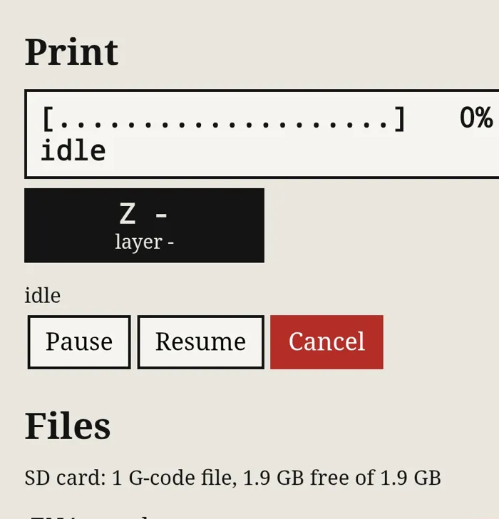
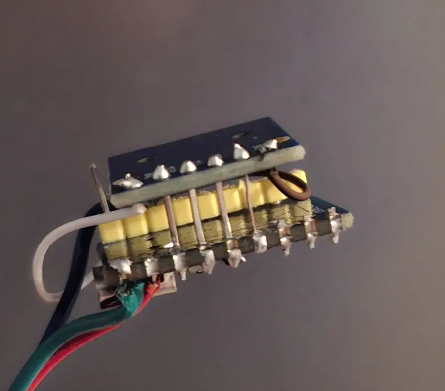
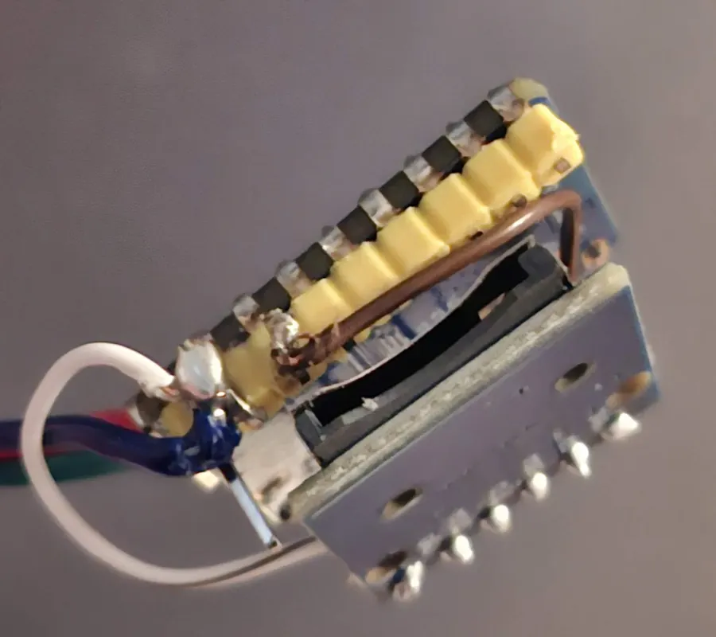
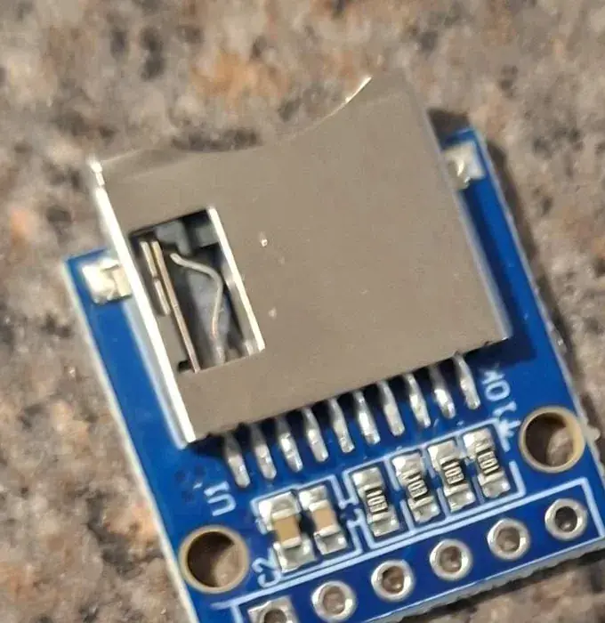

# Micro SD card for G-code files

**Status (2026-10-19): works on real hardware.** A bare micro SD module (socket, four 10k pull-ups, two
capacitors) piggy-backed on an ESP32-S3-Zero type board, on GPIO10-13: the card mounted (1.9 GB FAT32),
its file list, free space and upload to the card all worked from a phone. Printing a file from the card on
the printer is the next test. The printing logic it feeds (`SDCARD_PRINT_FILE FILENAME=`, M20 / M23 / M24)
is unit-tested on the PC.

Without a card, an uploaded file is compressed and kept in the ESP32-S3's own flash: 508 KB (1.75 MB on the SKIPPER build), enough for a
calibration cube. With a card, files are as big as the card, and you can also copy files onto it from a PC.

## Wiring

| SD module pin | ESP32-S3 GPIO (default) | Notes |
|---|---|---|
| CS | 10 | |
| MOSI (DI) | 11 | data **to** the card |
| SCK (CLK) | 12 | |
| MISO (DO) | 13 | data **from** the card |
| VCC | see below | solder a wire |
| GND | GND | solder a wire |

All four GPIOs can be changed on the **Settings** page (SD card section). The page refuses pins that clash
with the UART to the printer board, the status LED, the USB port (19/20), the boot pins (0, 3, 45, 46) or the
flash / PSRAM pins (26-37).

**Why 10-13.** On the ESP32-S3, GPIO10 (CS), 11 (MOSI), 12 (SCK) and 13 (MISO) are the SPI2 controller's own
pins, and on the ESP32-S3-Zero they are edge pins in a row next to TX/RX (the first default, 15-18, put
GPIO18 on one of the small pads underneath, which is hard to solder). The ESP32-S3 can route SPI to almost
any GPIO, so if your module's pin order does not line up, wire it as it is, or set four other free GPIOs on
the Settings page. Read the silkscreen next to each pin before soldering. If you saved settings on a build
that had 15-18 as the default, those saved values stay: change them on the Settings page.

### Plan it properly first (learned the hard way)

The module can sit straight on the ESP32-S3's edge pins as a "shield", with only VCC and GND as wires. The
first build here went wrong before it went right: the wrong pins were snipped, the module was soldered to
the other side, and only then did it become clear that **the ESP32 board's pins are mirrored once you flip
it over**. So:

1. Lay both boards out the way they will end up (which side faces which) **before** cutting anything.
2. **Mark the pins you will use with a permanent marker**: one line on each of GPIO10-13 on the ESP32
   board, and on the module's CS, MOSI, SCK, MISO. Put a **double line on the first pin** (GPIO10 and CS)
   so the orientation is obvious from either side.
3. Check the marks against the silkscreen on both boards (front and back), then check again.
4. Only then snip the header pins you do not need and solder.

The module used here (above, right) is a **bare adapter**: socket, four 10k pull-up resistors and two
capacitors, no regulator. That kind needs **3.3 V**.

**VCC: 3.3 V or 5 V?** It depends on the module:
- **Modules with a small regulator and a level-shifter chip** (the common blue "Micro SD Card Adapter"
  with 6 pins) expect **5 V** on VCC (the ESP32-S3 board's 5V pin). On 3.3 V their regulator may leave the
  card short of voltage.
- **Bare adapters** (just the card socket and a few resistors) expect **3.3 V**. 5 V would damage the card.
Look for a three-legged regulator (often marked AMS1117) on the module: if it has one, use 5 V.

## The card

- Format it **FAT32** (most cards up to 32 GB come that way). exFAT cards (most 64 GB+ cards) are not read.
- Put G-code files in the card's **top folder**. Names ending `.gcode`, `.gco` or `.g` are listed; long names
  are fine. Names with spaces work from the Printer page; for typed commands, use names without spaces.
- The card is checked at start-up. After swapping cards, press **Remount SD card** on the Printer page.

## Using it

- **Printer page, Files section:** the card's G-code files (marked "card", with **Print** and **Delete**)
  and the file kept in flash (marked "flash", with **Print**), and the card's free space.
- **Printer page, Print section:** a text bar, one character per 5 %, with time left, and a box with the
  current Z, the layer number and the layer height (from the slicer's comments when it writes them).
- **Upload** sends the file to the card (as plain G-code, not compressed) when a card is in;
  a broken upload never leaves a half file (it is written as `name.part` and renamed when complete).
- **Console / G-code:**
  - `SDCARD_PRINT_FILE FILENAME=benchy.gcode` (Klipper's command)
  - `M20` lists the files, `M23 benchy.gcode` selects one, `M24` starts it (Marlin style)
  - `SDCARD_PRINT_FILE` without a name still prints the file kept in flash
- Uploading, deleting and remounting are refused while a print runs.

## How it works (for the code)

- `firmware/esp32s3/main/sdcard.c`: SPI bus on SPI2, `esp_vfs_fat_sdspi_mount` at `/sd` (20 MHz, retried
  at 4 MHz for long wires or slow level shifters), internal pull-ups on MISO and CS, never formats a card
  by itself; listing, space, delete, and the pin checks.
- `link.cpp` `GcodeReader`: a named file is read from `/sd` with `fread`, 1 KB at a time, split into lines;
  the flash file keeps its compressed path.
- `main.c`: `POST /upload?dest=sd`, `GET /files.json`, `POST /sd?do=mount|delete&name=`, the Settings fields.
- `host/src/machine.cpp`: `SDCARD_PRINT_FILE FILENAME=`, M20, M23, M24; tested in `test_print_named_files`.
- Long file names: `CONFIG_FATFS_LFN_HEAP=y` in `sdkconfig.defaults`.
