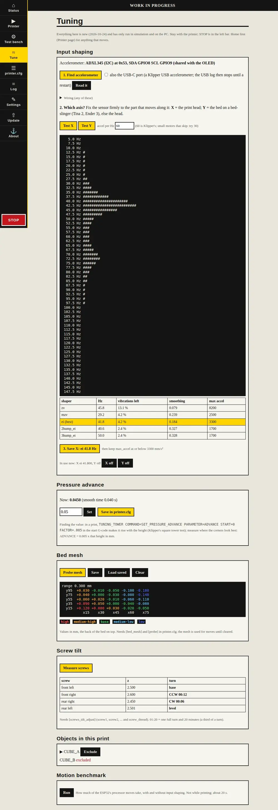

# Tuning: input shaping, pressure advance, bed mesh, screw tilt

**Status (2026-10-24): built and tested on the PC and under QEMU; nothing here has run on a printer
yet.** CAPTAIN and SKIPPER builds only (DECKHAND's 2 MB flash is full). Everything is on the new
**Tune** page (left bar) and works from the console with Klipper's own commands. How it works and
what it costs: [research/pressure-advance-input-shaping.md](research/pressure-advance-input-shaping.md).



## Input shaping (with an accelerometer)

Input shaping cancels the ringing ("ghosting") a printer frame makes after each change of
direction. The accelerometer measures where the frame rings; the ESP32 picks the shaper, as
Klipper's SHAPER_CALIBRATE.

**1. Find accelerometer.** Wire one of these, then press the button (it searches the spare pins
by itself and keeps what it finds):

| Sensor | Wiring | Notes |
|---|---|---|
| ADXL345 board, I2C | SDA and SCL onto the OLED's two wires (GPIO8, GPIO9), VCC 3V3, GND; CS to 3V3 | the easiest: shares the OLED's wires |
| MPU-6050 (GY-521) | SDA, SCL onto the OLED's wires (or any two spare pins), VCC 3V3, GND | 1000 samples/s |
| ADXL345 board, SPI | CS, SCL (SCK), SDA (MOSI), SDO (MISO) to any four spare pins, VCC 3V3, GND | Klipper's usual wiring |
| Klipper USB accelerometer (RP2040 + ADXL345: BTT ADXL345 V2, KUSBA, Mellow FLY-ADXL345, a Pico wired as Klipper's docs) | into the ESP32's USB-C port with an OTG adapter; tick "also the USB-C port" | **never run**; see below |

**USB accelerometer, before you try it:**
- It must run **Klipper v0.12 or newer** (2024 on). Older ones are refused with a message. To update: Flasher, Slave tab, **generic-rp2040** (Klipper v0.13.0, USB), hold BOOT on the accelerometer while plugging it into the computer, Flash.
- It looks for the ADXL345 on the usual RP2040 SPI pins one group at a time (0-3, 8-11, 12-15, 4-7, 16-19), then restarts the accelerometer board and sets up only the group that answered.
- **Power:** the ESP32-S3 does not make 5 V on its USB-C port by itself. Power the ESP32 from the printer board's 5 V and check the accelerometer's LED lights when plugged in; if it stays dark, that board passes no 5 V to its USB-C port and the accelerometer needs 5 V from elsewhere (a powered OTG Y-cable).
- While it is in use the ESP32's USB log and USB flashing stop until a restart (WiFi, web log and WiFi updates keep working).

The search drives the spare pins for a moment: have nothing else connected to them. **Read it**
shows the three readings; with the sensor still, the total is about 9807 (gravity).

**2. Which axis?** Fix the sensor firmly (a screw, not tape) to the part that moves along that
axis: for **X** the print head; for **Y** the bed on a bed-slinger (Tina 2, Ender 3). Home first,
then **Test X** or **Test Y**. The head goes to the middle and vibrates for about two minutes, from
5 to 135 Hz. It swings up to about 18 mm either way and reaches 8,000 mm/s^2 at the top: if the
motors skip (the Tina 2's small motors may), lower "accel per Hz" (try 30) and run it again.
Abort (Test bench) or STOP ends it at once.

**3. Save.** The page shows the spectrum (where the frame rings) and the five shapers with their
leftover vibration and smoothing; the best is highlighted. **Save** writes `[input_shaper]` into
printer.cfg (the board restarts). Keep `max_accel` at or below the suggested value.

Console: `SHAPER_CALIBRATE AXIS=X [ACCEL_PER_HZ=60] [FREQ_START=5] [FREQ_END=135] [POINT=x,y,z]`,
`TEST_RESONANCES AXIS=Y`, `SET_INPUT_SHAPER SHAPER_TYPE_X=ei SHAPER_FREQ_X=41.8 [SAVE=1]`,
`SET_INPUT_SHAPER SHAPER_FREQ_X=0` (off). printer.cfg, as Klipper:

```
[input_shaper]
shaper_type_x: ei
shaper_freq_x: 41.8
shaper_type_y: mzv
shaper_freq_y: 36.2
```

## Pressure advance

Pushes a little extra filament while speeding up and holds back while slowing down, so corners
are sharp and lines do not bulge. Klipper's formula, with `pressure_advance_smooth_time` (0.040 s).

Finding the value, as in Klipper's guide: slice a hollow square tower, put
`TUNING_TOWER COMMAND=SET_PRESSURE_ADVANCE PARAMETER=ADVANCE START=0 FACTOR=.005` in the start
G-code, print it, and find the height (mm) where the corners look best: ADVANCE = 0.005 x height.
Then on the Tune page type it and press **Save in printer.cfg**, or:

```
[extruder]
pressure_advance: 0.045
pressure_advance_smooth_time: 0.040
```

`SET_PRESSURE_ADVANCE ADVANCE=... [SMOOTH_TIME=...] [SAVE=1]` works in the console and in a print's
start G-code (SAVE is ignored in files).

## Bed mesh

Probes a grid and makes the nozzle follow the bed's shape. Needs a `[probe]` (the Tina 2 config
uses the sensorless Z one) and:

```
[bed_mesh]
mesh_min: 15, 15        # probe coordinates
mesh_max: 75, 95
probe_count: 3, 3       # 3 to 10 each way
horizontal_move_z: 5
```

Home, then **Probe mesh** (or `BED_MESH_CALIBRATE`, also from a print's start G-code: the print
waits for it). The heightmap shows the heights in mm with the back of the bed on top, coloured:
**high** red, **medium-high** orange, **base** green (within 20 % of the largest deviation from the
average), **medium-low** light blue, **low** blue. **Save** keeps it in printer.cfg as
`[bed_mesh default]` and it is used from the next start; **Clear** stops using it. Long moves are
split into 5 mm pieces so Z follows the mesh.

## Screw tilt

Tells you how far to turn each bed screw, as Klipper's SCREWS_TILT_CALCULATE:

```
[screws_tilt_adjust]
screw1: 30, 35
screw1_name: front left
screw2: 200, 35
screw2_name: front right
screw3: 200, 205
screw4: 30, 205
screw_thread: CW-M4      # CW-M3, CCW-M3, CW-M4, ... CCW-M6
horizontal_move_z: 10
```

**Measure screws** probes over each screw; the table says "base" for the first one and, for the
others, e.g. **CW 00:12**: clockwise, 12 minutes (a fifth of a turn; 01:00 is a full turn).
`SCREWS_TILT_CALCULATE DIRECTION=CW` picks the base so all turns go the same way.

## Also new (Klipper's commands)

- **Arcs** G2 / G3 (XY plane, `[gcode_arcs] resolution`, 1 mm by default): arc fitting in the slicer
  works now.
- **Firmware retraction** G10 / G11, `SET_RETRACTION`, `GET_RETRACTION`, `[firmware_retraction]`.
- **Exclude objects**: with "Label objects: firmware-specific" (PrusaSlicer / OrcaSlicer, Klipper
  flavour) the Tune page lists the objects of a running print with an **Exclude** button; the rest of
  that object is skipped (`EXCLUDE_OBJECT NAME=`).
- **TUNING_TOWER** (above).
- **Motion benchmark** (Tune page, `/bench`): how much of the processor the moves take on your board.

On the OLED: SHAKING during a resonance test, MESHING while probing the mesh, SCREWS while measuring.
