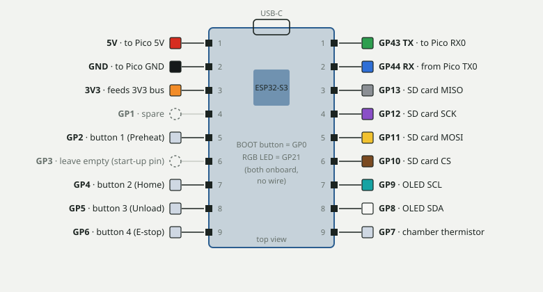
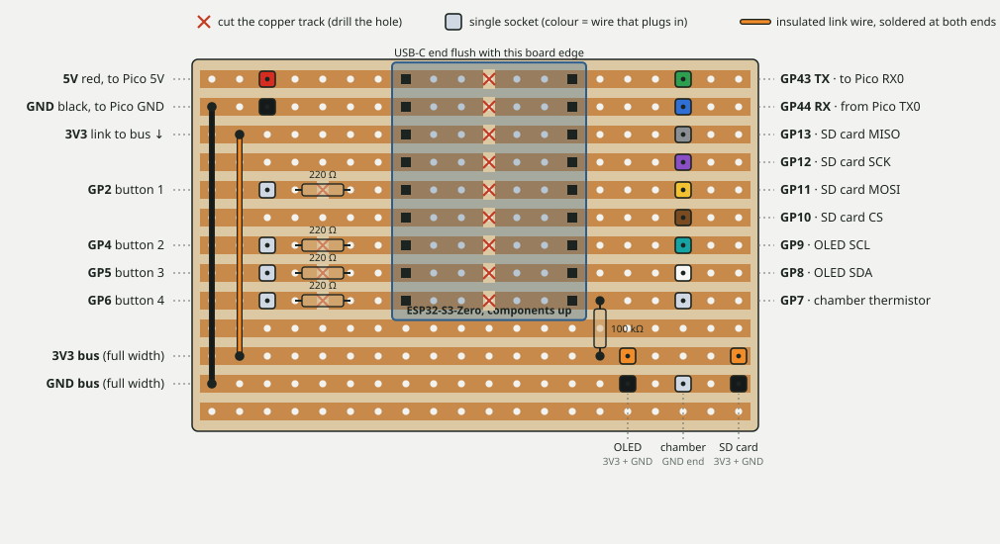
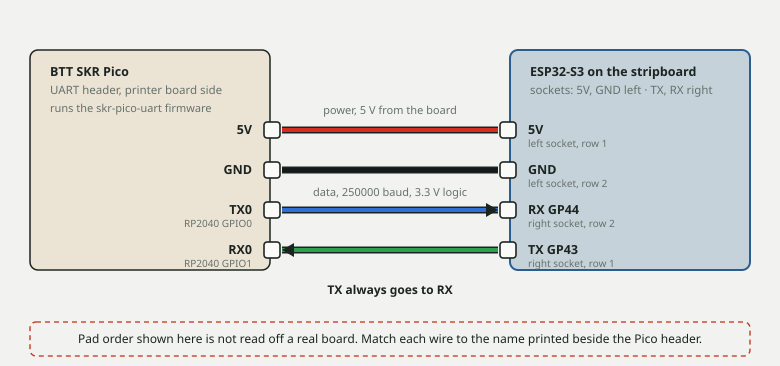

# Stripboard carrier for the ESP32-S3-Zero (2026-10-30)

> **Status: drawn, not yet built.** The pins are the firmware defaults. The pin order of the module is taken from the
> manufacturer's pin list and the repo's SD / OLED notes; the order of the four pads on the SKR Pico's UART header is
> **not** confirmed. Check both against the silkscreen before soldering.

A small stripboard (20 holes by 13 strips, about 51 x 33 mm) replaces the wires soldered straight onto the module.
Every wire plugs into its own socket, so the ESP32-S3 can be unplugged, and the red 5 V plug pulled while flashing.

## Build notes

- Strips run left to right. Cut each of the nine module rows once, between the two rows of module pins (drawn 6 holes
  apart, 15.24 mm: lay your module on the board first and move the right-hand side if yours is 7 apart).
- Leave the two bus strips (3V3, GND) whole. If a channel already runs the full height of the board, join each bus strip
  across it with a link wire or a solder bridge.
- Left row 2 (GND) links to the GND bus, left row 3 (3V3) to the 3V3 bus, with insulated wire.
- Touch buttons: a 220 ohm resistor across a cut in each of the GP2, GP4, GP5 and GP6 strips. Chamber thermistor: 100 kohm
  from the GP7 strip to the 3V3 bus.
- Before powering: each module row open between left and right pin, 3V3 bus open to GND bus, each socket beeps to its own pin only.
- Do not power the ESP32-S3 from USB and the 5 V wire together. Pull the red plug while flashing.

## Wire list

| Wire | From | To |
|---|---|---|
| red | Pico 5V | ESP 5V (left, row 1) |
| black | Pico GND | ESP GND (left, row 2) |
| blue | Pico TX0 (GPIO0) | ESP GP44 / RX (right, row 2) |
| green | Pico RX0 (GPIO1) | ESP GP43 / TX (right, row 1) |
| brown / yellow / purple / grey | SD CS / MOSI / SCK / MISO | GP10 / GP11 / GP12 / GP13 |
| orange / black | SD VCC / GND, OLED VCC / GND | 3V3 bus / GND bus |
| white / teal | OLED SDA / SCL | GP8 / GP9 |
| any | touch bolts 1 to 4 | GP2 / GP4 / GP5 / GP6 (each through 220 ohm) |
| any | chamber thermistor | GP7 and GND bus |

See also [WIRING_SKR_PICO.md](WIRING_SKR_PICO.md), [SD_CARD.md](SD_CARD.md), [OLED.md](OLED.md), [BUTTONS.md](BUTTONS.md), [CHAMBER_SENSOR.md](CHAMBER_SENSOR.md).
