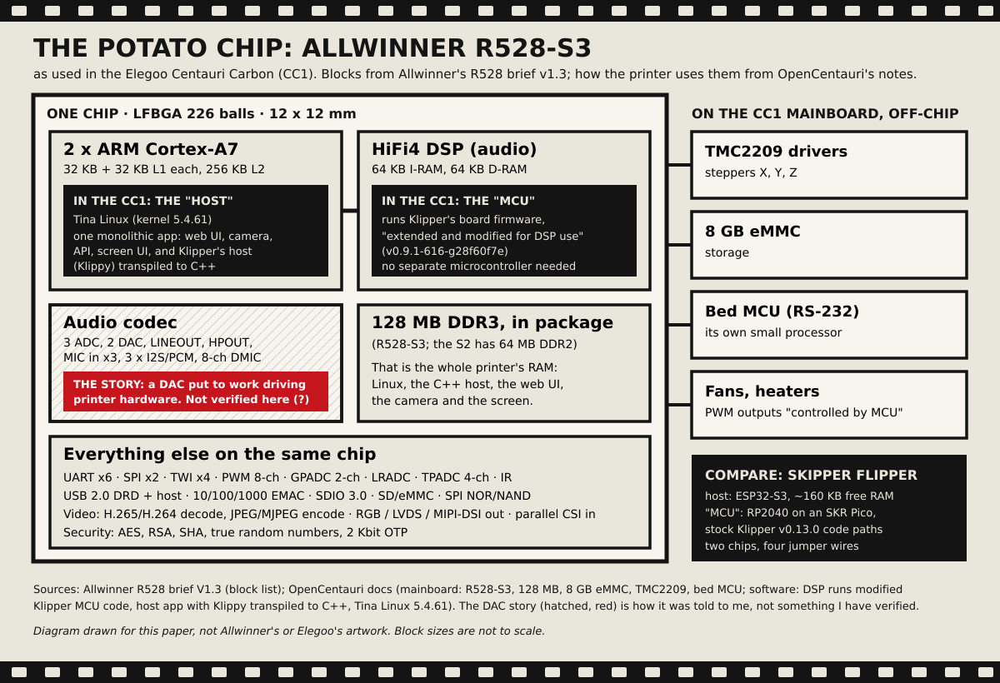
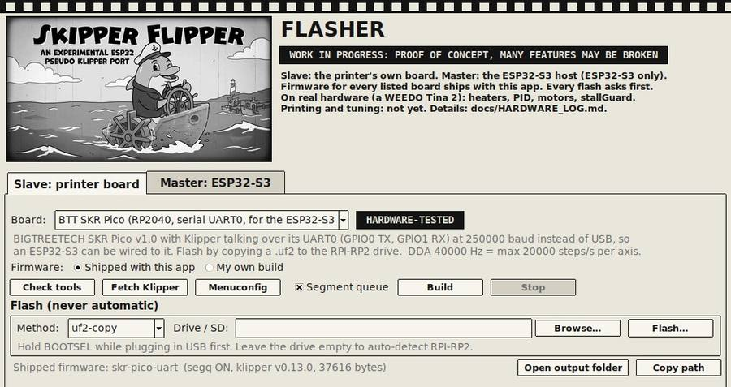
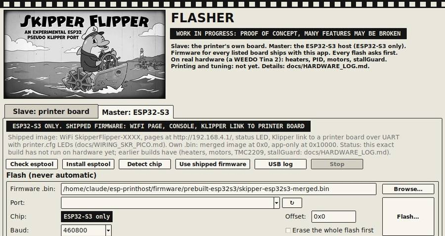
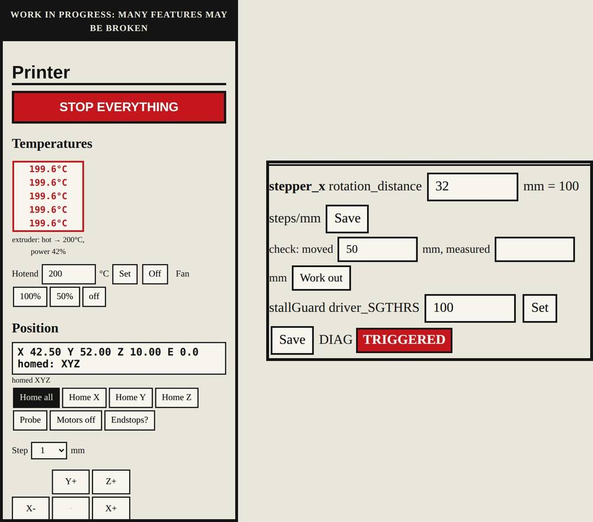

\ 

# A Frankenstein Experience

## How cheap and lean can a Klipper brain get?

**Field notes from Skipper Flipper: an ESP32-S3 microcontroller doing the Klipper host's job for a 3D printer board running stock Klipper firmware. Including every embarrassing mistake.**

Matthew Armstrong ([The-Dorkknight](https://github.com/The-Dorkknight)) · Version 1.2 · 29 October 2026 · Text CC BY-SA 4.0 · Code GPL-3.0

*Status: mostly working, needs tuning and proper testing. A hobbyist's field notebook, not peer-reviewed research. What ran on real hardware and what only ran in simulation is listed in section 12, and dated in the [hardware log](../HARDWARE_LOG.md).*

## 0. Abstract

Klipper is the 3D-printer firmware everybody wants and nobody's old printer can run without an extra computer. Its design splits the work in two:
- **the host** (normally Python on a Linux single-board computer) does the thinking;
- **the board's microcontroller** just does exactly what it is told, exactly when it is told.

I wanted to know how small that thinking computer could get. The answer so far is **an ESP32-S3**:
- a microcontroller board that costs a few pounds;
- 512 KB of on-chip RAM, of which about 160 KB is free once WiFi is running;
- the smallest build fits in 2 MB of flash; the board I now use has 4 MB of flash and 2 MB of extra RAM (PSRAM), which the bigger build uses.

It talks to a BTT SKR Pico running plain Klipper v0.13.0 board firmware over four jumper wires, and serves the whole user interface from its own WiFi hotspot to a phone.

**New in version 1.2:** it now homes all three axes on the real printer and has run a whole print file, though in mid-air (section 5). A benchmark that pushes about a million steps through the whole pipeline to the real board shows the ESP32 doing about 14 % of one core of real work, and an integer-maths build runs input shaping in about half the processor time (section 6).

Along the way I powered a 12 V heater from 20 V, and my AI co-pilot asked a chip with no spare RAM for 45 KB in one lump. Between us we also nearly cooked a circuit board through its data pin. All of it is written down here, because the dead ends are the useful part.

## 1. How this started

### 1.1 The habit

Every so often I impulse-buy a small junk 3D printer on eBay for about twenty quid (twenty bucks, in internet money). The challenge is always the same: get it printing as cheaply as possible, enjoy it for a bit, then offload it when I've had my fun. It is a cheaper hobby than it sounds and a more educational one than it should be.

The sticking point with these printers is always the brain:
- **Stock firmware** on small printers is usually closed, dated, or both.
- **Marlin** works, but every change means editing `Configuration.h`, recompiling and reflashing.
- **Klipper** is lovely: a text config file, pressure advance, input shaping, a proper web interface. But it wants a Linux computer next to the printer, and on a twenty-quid printer that computer can cost more than the printer did.

### 1.2 The spark: Elegoo's potato chip

Then Lost in Tech ([@LostInTech3D](https://www.youtube.com/@LostInTech3D)), a 3D-printing YouTube channel, made me aware of what Elegoo had done inside the Centauri Carbon, and I went down the rabbit hole. I came out with a great deal of respect for some properly mad science.

Normally a Klipper printer has two brains: a Linux computer running Klipper's host, and a separate microcontroller on the printer board. The Centauri Carbon has **one chip**, which I'll call the **potato chip** with real affection. OpenCentauri's documentation lists it as an **Allwinner R528-S3** with 128 MB of in-package memory and 8 GB of eMMC storage ([OpenCentauri](https://docs.opencentauri.cc/hardware/CC1/mainboard/)). Elegoo made it do both jobs:
- **The host:** the chip's two ARM Cortex-A7 cores run Tina Linux and one big program with the web UI, the camera, the screen and Klipper's host. That host has been translated from Klipper's Python into C++ ([OpenCentauri software notes](https://docs.opencentauri.cc/software/)).
- **The "microcontroller":** there isn't one. The chip's built-in **HiFi4 audio DSP**, a processor meant for sound, runs Klipper's board firmware on bare metal, "extended and modified for DSP use" (same source).
- **The bit I love most, as it was told to me:** the chip didn't have enough GPIO pins for a 3D printer, so the story goes that an internal **audio DAC** was repurposed to drive printer hardware, with the rest bit-banged. I haven't been able to verify that from documentation, so treat it as the story that hooked me rather than an established fact.

Either way, it's a lot of engineering bent sideways in pursuit of the elusive efficiency, "irregardless" of their legally interesting choices. (The quotation marks are on purpose.)

**Those legally interesting choices, as reported:**
- **Closed at first:** the firmware shipped closed. People asked for its source under the GPL, and critics said it was a heavily modified Klipper. All3DP reports that Elegoo said otherwise, then published code in September 2025 and added licence information in November 2025 ([All3DP](https://all3dp.com/4/elegoo-releases-centauri-carbon-firmware-code-but-questions-remain/)).
- **Today:** Elegoo's repository for the printer is under GPL-3.0 and names the R528 as the main control platform ([elegooofficial/CentauriCarbon](https://github.com/elegooofficial/CentauriCarbon)). An AI-generated summary of the later CentauriCarbon2 repository describes it as derived from Klipper, with a C++ host and C board firmware ([DeepWiki](https://deepwiki.com/elegooofficial/CentauriCarbon2)).

I'm not judging anyone's licensing: read the sources and make your own mind up.

What caught my engineering brain was this. Klipper normally runs its host in Python on a Linux computer with hundreds of megabytes to spare. Elegoo ran it, compiled and slimmed down, on a potato chip, with the board firmware squeezed onto an audio processor. So the obvious next question is: **how far down can you go?**

What is the cheapest, leanest Frankenstein that still behaves like Klipper? Dangle a question like that in front of an engineer and it's catnip.

### 1.3 The rules I set

1. **Don't fork Klipper's brain, borrow its spine.** The board keeps running Klipper's own firmware, so every board Klipper supports could in principle work. For a while it ran a light fork; since 25 October it runs plain, unmodified Klipper v0.13.0 (section 3.4).
2. **The host must be a microcontroller,** not a Linux computer: an ESP32-S3, the cheapest thing I could find with WiFi and enough memory to try.
3. **Everything happens in a phone browser.** There's no app to install and no PC needed once it's flashed.
4. **The setup tool must run on a 7th-generation Core i3** and set itself up in one step. If a twenty-quid printer needs a gaming PC to configure, the joke is on me.
5. **Be honest about what's tested.** Every result is labelled real hardware, simulation or compile-only.

## 2. What Klipper's host actually does, and what fits on a microcontroller

Klipper's board firmware is deliberately simple. It queues timed steps, switches pins at scheduled clock ticks, reads sensors on a schedule, and shuts everything down if the host stops topping up the heater's watchdog. All the cleverness lives in the host:

| Host job (Klipper Python module) | On the ESP32-S3 | Status |
|---|---|---|
| Serial protocol, data dictionary, retransmits (`serialhdl.py`, `msgproto.py`) | C++ `KLink`; the dictionary is unpacked with the ESP32's ROM inflater | real hardware |
| Clock sync (`clocksync.py`) | `ClockSync`: one sample a second, drift tracked | real hardware: 41 minutes, 12,000,464 Hz measured (+38.7 ppm), 0 CRC errors |
| Turning `printer.cfg` into board commands (`mcu.py`, the `extras/`) | `build_board_plan`, with the same config CRC Klipper uses | real hardware |
| Heater control (`heaters.py`): PID, the watermark "bang-bang" control, `verify_heater`, PID tuning | Ported from Klipper's code, including its 5 s heater watchdog | real hardware |
| TMC2209 over the driver UART (`tmc2209.py`, `tmc_uart.py`) | Register values checked bit for bit against Klipper's own code | real hardware: all drivers answer |
| Look-ahead planner and step generation (`toolhead.py`, `chelper`) | The project's planner, plus a step compressor that fits Klipper's `queue_step` within 25 µs | real hardware: homing, a whole print file (in mid-air) and a million-step benchmark; the accuracy is checked in simulation |
| Homing, probing, sensorless homing (`homing.py`, `tmc.py`) | Same board commands, same sample timing, same register juggling | real hardware: full homing of X, Y and Z (27 October); probing in **simulation** |
| G-code files (`virtual_sdcard.py`) | A micro SD card soldered to the ESP32, or (without a card) a compressed file in 576 KB of flash | real hardware: a whole file run end to end |
| Input shaping and pressure advance (`input_shaper.py`, `extruder.py`, `chelper`) | Ported on the bigger builds, on a 2 ms grid; an integer version for the test build | maths timed on the ESP32; **not yet on a moving printer** |
| The web interface (Moonraker + Mainsail/Fluidd) | Text-only pages served by the ESP32 itself | real hardware |

What I left out is as important as what went in:
- **Version 1.1 left out** input shaping, bed meshes, pressure advance, arcs (G2/G3) and firmware retraction. They have since been ported on the bigger builds (CAPTAIN and SKIPPER), but none of them has moved a real printer yet.
- **Still left out:** Klipper's Jinja macro language. Plain macros work; a macro with `{...}` templates is refused with a clear message rather than half-understood.
- **Trimmed from the interface:** no graphs. Temperatures are coloured text boxes that scroll up while heating and down while cooling, because a graph costs flash and a coloured number doesn't.

There are now three builds, by how much memory the ESP32 board has. The smallest (DECKHAND) is **1,436,112 bytes** in a 1,441,792-byte app slot: about 6 KB free, which is tight. The one in the Tina 2 (CAPTAIN) is 1,690,064 bytes with about 14 KB free. The portable C++ core that does the host's job is now about 12,500 lines, and the same code runs on a PC for testing.

## 3. The Frankenstein, part by part

### 3.1 The parts

| Part | What it is | Job |
|---|---|---|
| Brain | ESP32-S3 mini board (512 KB SRAM, 2 MB flash used) | Klipper's host jobs, WiFi hotspot, web pages, stores the G-code file |
| Spine | BTT SKR Pico (RP2040, four TMC2209 drivers) | Klipper's own board firmware, over UART at 250,000 baud |
| Nerves | Four jumper wires: TX, RX, GND (and optionally 5 V) | That's it |
| Body | A WEEDO Tina 2, with a slightly bigger custom printhead | The victim |
| Face | Any phone browser | Status, console, `printer.cfg` editor, test bench, printer controls |

\ 

### 3.2 The Test bench, or how to debug a printer from your phone

Every subsystem got a **Test** button with an **Abort** button next to it. That meant the hardware could be checked one piece at a time, from a phone, without anything else attached:
- a heater test with a ±5 °C pass rule;
- a heater-output (MOSFET) check;
- Klipper's PID tune;
- a motor test (clockwise, anticlockwise, then a shake);
- a TMC2209 check;
- fan and LED tests;
- since 14 October, a **stallGuard test**: it reads the driver's stall value while the motor runs, checks the DIAG wire with the most sensitive setting, and suggests a threshold. A box goes red when the driver says "stalled".

### 3.3 Safety, Klipper-style

All of Klipper's own heater protections are ported, and the error display goes black so you can't miss it:
- the board-side 5 s watchdog;
- the ADC range check;
- `verify_heater`'s heating-rate and hysteresis checks.

Two checks are new:
- **Heated with its output off:** if a heater keeps heating after the controller has switched it off, the page says, in big red letters, to switch off the 12–24 V supply.
- **A heater test that actually fails:** it no longer passes a heater that overshoots by 10 °C (see mistake 7).

### 3.4 "Is the board firmware stock?" Almost.

Version 1.1 said "almost". The SKR Pico then ran Klipper v0.13.0 with three extra source files for an experimental "segment queue", which is why it reported itself as `v0.13.0-0-g61c0c8d-dirty`. The ESP32 never used it: it drives the motors with Klipper's own `queue_step` command.

**Since 25 October the answer is yes.** The segment queue was removed ([why](../research/segq-retired.md)), and the board runs plain, unmodified Klipper v0.13.0. The ESP32's firmware is the only bespoke part of the whole system. That matters, because "is it stock or our fork?" is the first question to ask whenever something misbehaves.

### 3.5 Why everything is a boat

Everything in 3D-printer firmware is nautical:
- **Marlin** is a fish;
- **Klipper** is a fast sailing ship;
- the test print everyone uses is a little tugboat called **Benchy**.

So this had to float too. **Skipper Flipper** is a skipper (the captain of a boat) who is also a dolphin (flippers), and the tool flips firmware onto boards.

The look is a 1928 black-and-white steamboat cartoon: grainy paper, heavy ink, film-strip borders. That era is fair game: Disney's *Steamboat Willie* (1928) entered the US public domain on 1 January 2024 ([Duke Center for the Study of the Public Domain](https://web.law.duke.edu/cspd/publicdomainday/2024/)). Only the original 1928 film is free, though. Disney's later versions and trademarks are not, which is why our skipper is a dolphin and not a mouse. Benchy belongs to someone else too, so it's a paddle steamer instead of a tugboat. No IP was harmed in the making of this boat.

## 4. The hall of shame

Every mistake, in roughly the order they happened. Some are mine, some are my AI co-pilot's, and all of them are now somebody else's shortcut.

**1. The USB host that never was.** The first plan was for the ESP32-S3 to talk to the printer board over USB, as a USB host. I plugged the ESP32 into a USB-C hub and was surprised when nothing happened. The firmware wasn't a USB host, and the board has no power-delivery chip. Four jumper wires on a UART did the job instead.

**2. The salvaged ribbon cable.** It was free, which turned out to be the most expensive thing about it. The ESP32 heard garbled copies of its own requests, because its TX signal was leaking into its RX wire. On the bright side, it led to the byte counters, echo detection and loopback self-test on the status page.

**3. The 4 KB web server.** Opening a page made the WiFi vanish: the page handlers had overflowed the web server's 4 KB stack. Then the data dictionary's unpacker put 11 KB of state on a 12 KB stack. Microcontrollers are good at teaching you where every byte lives.

**4. Loose connections, twice.** One "no link" was a loose jumper wire. The other "no link" was a connector that had come adrift. Both times the firmware was blamed first and was innocent.

**5. The BOOT jumper.** I left the SKR Pico's BOOT jumper on after flashing, or flashed the USB version of the firmware instead of the UART one. Nobody is quite sure which, which is its own lesson. The Flasher app now reminds you about both.

**6. A 12 V hotend on 20 V.** The best one. A scrap heater cartridge from the parts box measured 15 Ω. On its rated 12 V that's 12² / 15 = **9.6 W**. On my 20 V supply it was 20² / 15 = **26.7 W**, nearly three times as much.

It heated so fast that the cartridge outran the thermistor, overshot, and tripped Klipper's "ADC out of range" safety shutdown. The safety systems worked perfectly. The engineer did not.

The fix, if you insist on doing this: in `printer.cfg`, set `max_power` to (rated V / supply V)², which is 0.36 here, then run a PID tune.

**7. A test that passed a failure.** The first heater test called a 10.5 °C overshoot a pass. It now passes only within ±5 °C, the same window Klipper's own `verify_heater` uses.

**8. The board that locked up green.** Once, after a safety shutdown, the SKR Pico stopped answering until it was unplugged. The cause is still unknown. It led to automatic resets and much better diagnostics, and it is still on the list.

**9. "Timer too close".** Writing to the TMC drivers takes a few milliseconds. Code that had noted the time *before* those writes then scheduled pin changes in the past, and Klipper's board firmware quite rightly refused. Everything now re-reads the clock after anything that blocks.

**10. Two steps per command.** The first step compressor sent Klipper's board one command for every two steps, which is like posting a letter for every word. It now sends one command for about every hundred steps, within Klipper's 25 µs accuracy. In simulation, that is.

**11. 45 KB, please.** The motion planner was developed and tested on a PC, which has 16 GB of RAM. On its first real run it asked the ESP32 for **45 KB in one piece** for its look-ahead buffer, didn't get it, and crashed. Then it rebooted, connected, asked again, and crashed again. A crash loop.

The backtrace, decoded against the exact firmware image, pointed straight at it. The planner now looks 32 moves ahead (about 6 KB), and memory is checked first so a shortage gives an error message instead of a crash.

The board's listing advertised 2 MB of PSRAM that the firmware had never switched on. It is really there: the bigger build found it on 20 October and now uses it for 256 moves of look-ahead.

**12. Feeding a switched-off board through its data pin.** This is the subtlest one. When the ESP32 runs on its own USB power and you switch the printer board off, the ESP32's TX wire is still sitting at 3.3 V. A little current leaks into the dead board's RX pin and half-powers it. When its own supply comes back, the board doesn't restart properly: it answers nothing and holds its TX line low, so all the ESP32 hears is a stream of zeros.

"Reset it from the ESP32" can't help a board that isn't running. It's the most likely explanation from the symptoms, but it wasn't measured. Three fixes:
- **The firmware:** it now lets go of its TX wire whenever the board goes quiet, and only talks again once the board's TX line is back high.
- **The wiring:** power the ESP32 from the printer board's 5 V pin, so both switch off together.
- **Hardware:** a series resistor in that one wire would also limit the leak. I haven't tried it.

**13. Giving up and sulking.** The old reconnect logic tried resetting a stubborn board three times, then just sat there forever. It also didn't notice when the board restarted itself, so it kept sending commands for things the fresh board had never heard of, and the board shut down in protest. All of that connection logic now lives in one class that the PC tests power-cycle, hang and feed garbage to.

**14. Messages that lied.** Setting the hotend to 230 °C during a heater test produced "the target was changed by another command". Stopping a PID tune said "heater off" while the heater was in fact heating to the new target. The code was right, but the words made it look broken. The replies now say what actually happened.

**15. The 6 KB status page.** The printer status was copied into a fixed 6 KB buffer and quietly cut off when it was longer. The Tina 2's 16 test rows, plus a long stallGuard report, could break the pages. The ESP32 now sends the whole thing.

**16. Educated guesses dressed as settings.** The Tina 2 preset started out with guesses for the stallGuard threshold, the motor current (0.5 A) and the homing speed. They were labelled as guesses, but they were still guesses. On the first real run, stallGuard triggered too lightly and the moves looked slow. That's why the Test bench now has threshold and `rotation_distance` boxes, plus a "moved this far, measured that far, work it out" helper. The real answers come from measuring, not from me.

**17. Found while making the pictures for this paper.** To get a nice screenshot I started a stallGuard test and then pressed Home X while the test was still running the same motor. Both tried to drive the stepper at once, and the simulated board shut down with "Can't reset time when stepper active". Klipper's own board firmware is right to refuse, and nothing in the ESP32 had stopped me doing it. Homing, moves and jogging are now refused while a motor test runs. The paper found a bug before the printer did.

**18. Doing all the homework before handing any in.** The first real "Home all" shut the board down with "Timer too close". The Z homing move is 123 mm at 4 mm/s: 49,200 steps. The ESP32 worked out every one of them before sending the first, which took about 0.4 s, and the move had been given a 0.3 s head start. The homing move is now sent like any other: the first 0.6 s at once, the rest while it runs.

**19. The web page that stopped the motors.** "Timer too close" came back on 27 October, both times while the Printer page was loading a G-code preview over WiFi. The task that talks to the printer board shared a processor core with the web server, at a lower priority, so a busy page could hold it off until planned steps arrived late. It now has the second core to itself. The same evening, full homing worked for the first time.

**20. The print in mid-air.** That same evening a whole print file ran from start to finish, and the nozzle never touched the bed. The Tina 2's Z axis has a flexible coupling and a gantry that pulls unevenly, so it has no sharp stop to measure a Z offset from, and its tiny Y motor overheats even at 0.3 A. It's retired as the test bench. Next is a QIDI X-Smart 3, a CoreXY whose own toolhead board is dead, with the SKR Pico in its place.

**21. 200 is not 1,024.** A new benchmark (section 6) stopped six times on the Tina 2 with a move "refused as too late". The ESP32 limits how many commands it puts in the board's queue, and it read the queue size from the board before configuring it, when Klipper reports 0. So it fell back to a cautious 200 instead of the SKR Pico's 1,024, and fine detail couldn't be queued far enough ahead. It now reads the size again after configuring. The benchmark has run to the end every time since. The useful part: the run only revealed the cause after we added a message that said how full the queue was ("board move queue 0 of 200").

**22. The image at the wrong address.** The Flasher put a firmware image meant for WiFi updates at the address for a full image over USB, and the ESP32 didn't boot. Re-flashing the full image fixed it. The Flasher now reads the file itself to tell what kind of image it is, sets the address, and refuses a wrong one.

**23. A benchmark that compared nothing.** The integer-maths test build and the standard build gave exactly the same input-shaping figures in the motion benchmark, to two decimal places. That's because the benchmark had its own copy of the motion pipeline, which always used the standard shaper. Once fixed, the difference showed up straight away (section 6). If two things you're comparing come out identical, check that you're actually measuring both.

## 5. What actually works (and what doesn't yet)

| | Real hardware | Simulation only | Not working / unknown |
|---|---|---|---|
| Link | UART link, identify, clock sync, configuration, automatic reset, recovery from board power cycles, the console from a phone, firmware updates over WiFi | | |
| Heat | Thermistors, heater PWM, PID tune ("works quite well"), the heater test, safety shutdowns, error display | | |
| Motion | Motor test, TMC2209 set-up, stallGuard, **full homing of X, Y and Z**, a whole print file's moves (in mid-air), the benchmarks | Probing | Input shaping, pressure advance and bed mesh on a moving printer |
| Printing | Uploading to flash or the SD card, **running a whole file** | Pause, resume, cancel | **No real part printed yet** (no usable Z offset on the Tina 2) |
| Extras | The OLED, touch buttons through the case, the important-events log | Slicer uploads, home WiFi | |
| Fans | Hotend fan confirmed | Fan commands and tests | Part-cooling fan and third fan output not confirmed yet: possibly a broken wire |

## 6. So how cheap and lean can it get?

The honest answer, at this point:
- **The cheapest Klipper-ish brain is a few-pound ESP32-S3 bolted onto the board the printer already has,** as long as that board's processor can run Klipper's firmware. The SKR Pico here was a stand-in for exactly that.
- **The leanest working host I've managed** fits in 1.4 MB of flash and runs in the RAM left over after WiFi, which is about 160 KB free.
- **For scale,** the potato chip in the Centauri Carbon has 128 MB of memory, from section 1.2's sources. That isn't a criticism of Elegoo. Their printer does a great deal more than this one, and they had a whole engineering team. It is just a sense of how much slack there is in "Klipper needs a computer".

**The cost of going this lean:**
- input shaping, pressure advance and bed mesh only on the bigger builds, and not yet proven on a moving printer;
- a text-only interface;
- big G-code files need the SD card (without one, 576 KB of compressed flash);
- a design where the host and the board must agree on every byte, because there's no operating system to hide the mistakes behind.

### 6.1 Measured on the real chip

Version 1.1 could only guess at whether the ESP32 had the processing power. Now there's a benchmark (`SF_BENCH`). It runs a 12-layer print-like file (9,617 lines, about a million steps, including a run of 300 tiny 0.25 mm moves) through the whole motion pipeline and the real SKR Pico, with the stepper drivers and heaters switched off. Every stage is timed with the processor's cycle counter. On the Tina 2, 29 October:

| Stage | Share of one core |
|---|---|
| Look-ahead planner | 2.2 % |
| Step times | 0.5 % (0.1 % with integer maths) |
| Compressing steps into Klipper's `queue_step` | 7.4 % |
| Sending, including waiting for the board to acknowledge | 29.7 % |
| Everything else (G-code, file, heaters) | 4.6 % |
| **Total** | **about 44 %** |

The run takes 121.8 s either way, and the board's 1,024-command queue never gets more than about 384 deep. Leave out the waiting and the ESP32 is doing about **14 % of one of its two cores**. So the processing power is there: the biggest single cost is the ESP32 sitting idle while each batch of commands is acknowledged. Klipper's host keeps sending and collects acknowledgements as they come in, and copying that is the next speed work.

The Tina 2's `printer.cfg` has no input shaper, so a second benchmark times the expensive maths on its own:

| Print path, input shaping + pressure advance | Standard (double) | Integer test build |
|---|---|---|
| 100 mm/s | 22.1 µs per step, 19 % of one core | 11.6 µs per step, 10 % |
| 200 mm/s | 15.1 µs per step, 23 % | 9.1 µs per step, 14 % |

The ESP32-S3 has no hardware for 64-bit floating point, so `double` maths runs in software. Doing input shaping in whole numbers (times in microseconds, positions in 1/65,536 of a step) makes the shaping work itself about **3.7 times faster**, and on the PC it stays within one step of the `double` version everywhere. It hasn't driven a real motor yet.

## 7. Why I'm stopping here (version 1.1), and why I didn't

Version 1.1 said: now that I've defeated the main engineering challenge, I've lost interest. Proving it can be done was the catnip; tuning stallGuard thresholds is not. I promised two more versions, a tuned one and an SD-card one, and then the Tina 2 would go the way of all my twenty-quid printers.

The SD-card version happened. The tuned one ran into the Tina 2's floppy Z axis (mistake 20). In between, the question changed from "can it be done?" to "how fast can it go?", which turned out to be catnip too. The Tina 2 is retired as the test bench. The QIDI X-Smart 3 takes over, and the first real printed part is the next milestone.

My employability, for the record, has gone up by roughly another 3.14159 %. That's a very efficient use of an evening, with excellent synergy.

## 8. A Frankenstein experience, for people as well as printers

Frankenstein's monster was stitched together from other people's parts. So is this, and that's the point. Thank you to:
- **Lost in Tech ([@LostInTech3D](https://www.youtube.com/@LostInTech3D)),** the 3D-printing YouTube channel, for making me aware of the Elegoo story in the first place.
- **Everyone behind Klipper:** the hard thinking, the protocol and the safety design are theirs. This project is a translation of their ideas into a smaller language, nothing more.
- **Bart Dring and everyone behind FluidNC,** for showing how much machine control an ESP32 can do on its own. That was an early inspiration for putting the brain on an ESP32 at all.
- **Anycubic,** for Klipper-go, a port of Klipper's host to the Go language for their own printers, and the matching board firmware, both given to the community ([Klipper-go](https://github.com/ANYCUBIC-3D/Klipper-go)). It's proof that Klipper's host can be made small enough to live inside the printer.
- **Elegoo,** for the potato chip and the mad science, and in the end for publishing the code.
- **OpenCentauri** and the people who asked for the Centauri Carbon's source: they made the facts in section 1.2 findable.
- **BTT,** for the SKR Pico and the published pin settings that confirmed my guesses about the DIAG pins.
- **gistogisto,** for the community Tina 2 Klipper config, which is where the Tina 2's mechanics came from.

If you have a junk printer and a spare ESP32-S3, have a go:
- **Post your results,** good or bad, as an issue or discussion on the repository. Photos of things going wrong are especially welcome. Failure is data.
- **Add your board.** Klipper's firmware runs on dozens of chips. The Flasher already ships compile-only builds for a Creality 4.2.x, an Ender 3 1.1.x, RAMPS on a Mega2560 and generic RP2040 boards. None has been tried on real hardware yet: each one needs someone with the board and a free evening.
- **Fork it.** Try input shaping on a printer that moves, make sending work without waiting for every acknowledgement, make the pages nicer than my text boxes.

Everyone who contributes gets credited in the next version.

## 9. How this was made

**My part:**
- the design intent and the rules in section 1.3;
- the hardware, the wiring and every test on real hardware;
- most of the jokes;
- several of the mistakes.

**My AI co-pilot's part** (an AI assistant working to that design intent):
- the code, the simulated printer board and the tests;
- the literature digging;
- the first draft of this write-up;
- its own share of the mistakes (numbers 3, 7, 9, 10, 11, 13, 14, 15, 17, 18, 19, 21, 22 and 23, for the record).

Every real-hardware result in this paper is mine, measured on my bench, and dated in the [hardware log](../HARDWARE_LOG.md). Every simulated result says so.

## 10. Sources

- Klipper documentation, protocol and source (v0.13.0): [klipper3d.org](https://www.klipper3d.org/), [Sensorless homing](https://www.klipper3d.org/Sensorless_Homing.html)
- BTT SKR Pico: [Klipper config](https://github.com/bigtreetech/SKR-Pico/blob/master/Klipper/SKR%20Pico%20klipper.cfg), [wiki](https://global.bttwiki.com/SKR%20Pico.html)
- WEEDO Tina 2 community Klipper config: [gistogisto/Tina2Klipper](https://github.com/gistogisto/Tina2Klipper)
- FluidNC: [github.com/bdring/FluidNC](https://github.com/bdring/FluidNC)
- Anycubic Klipper-go: [ANYCUBIC-3D/Klipper-go](https://github.com/ANYCUBIC-3D/Klipper-go)
- Allwinner R528 brief V1.3 (block list for figure 1): [R528_brief_V1.3.pdf](https://server7.whycan.com/files/allwinner/r528/a/Hardware硬件类文档/芯片手册/R528_brief_V1.3.pdf)
- Steamboat Willie and the public domain: [Duke CSPD, Public Domain Day 2024](https://web.law.duke.edu/cspd/publicdomainday/2024/)
- Lost in Tech, 3D-printing YouTube channel: [@LostInTech3D](https://www.youtube.com/@LostInTech3D), where I first heard about the Centauri Carbon's insides
- Centauri Carbon:
  - [OpenCentauri mainboard documentation](https://docs.opencentauri.cc/hardware/CC1/mainboard/) and [software notes](https://docs.opencentauri.cc/software/)
  - [elegooofficial/CentauriCarbon](https://github.com/elegooofficial/CentauriCarbon)
  - [DeepWiki summary of CentauriCarbon2](https://deepwiki.com/elegooofficial/CentauriCarbon2) (AI-generated)
  - [All3DP, "Elegoo Releases Centauri Carbon Firmware Code, But Questions Remain"](https://all3dp.com/4/elegoo-releases-centauri-carbon-firmware-code-but-questions-remain/)
- This project:
  - [HARDWARE_LOG.md](../HARDWARE_LOG.md)
  - [research/klipper-sources.md](../research/klipper-sources.md)
  - [research/klipper-grade-performance.md](../research/klipper-grade-performance.md)
  - [BENCHMARK.md](../BENCHMARK.md)
  - [TINA2_INSTALL.md](../TINA2_INSTALL.md)
  - [WIRING_SKR_PICO.md](../WIRING_SKR_PICO.md)

## 11. How to cite

Armstrong, M. (2026). *A Frankenstein Experience: how cheap and lean can a Klipper brain get? Field notes from Skipper Flipper, including every embarrassing mistake.* Version 1.2, 29 October 2026. https://github.com/The-Dorkknight/esp-printhost

Text and figures: [CC BY-SA 4.0](https://creativecommons.org/licenses/by-sa/4.0/). Code: GPL-3.0, like Klipper.

## 12. Status and disclaimers

**What ran where (29 October 2026):**
- **On real hardware:** the link, clock sync and board configuration; temperatures, heating, PID tuning and the safety shutdowns; motors, TMC2209 drivers and stallGuard; full homing of X, Y and Z; a whole print file (in mid-air); the SD card, OLED and touch buttons; both benchmarks, with the drivers off.
- **Only in simulation:** probing; pause, resume and cancel. Input shaping, pressure advance and bed mesh have been timed on the ESP32 but have not moved a real printer.
- **Not confirmed yet:** a real printed part; the part-cooling fan and the third fan output (the hotend fan works; possibly a broken wire); the integer maths driving real motors; and the cause of one early board lock-up.

**Disclaimers:**

- **About Elegoo:** what section 1.2 says about Elegoo and the Centauri Carbon comes from the cited sources, and is reported, not tested by me. Nothing here is a legal claim about anyone's licensing.
- **Safety:** none of this is a recommendation to run hardware outside its ratings. Mistake 6 is a warning, not a technique.
- **Electrical:** the half-powered-board explanation in mistake 12 is an inference from the symptoms, not a measurement.
- **Your printer:** heaters can start fires. Stay with any printer running experimental firmware, keep a hand near the power switch, and use a thermistor that's actually in the block.

